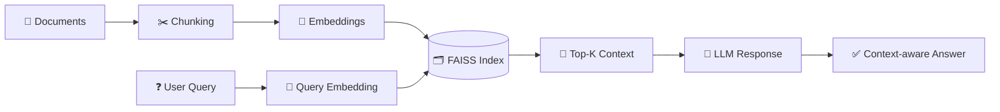

<div align="center">


<a href="https://git.io/typing-svg">
  
</a>

<br/>

<a href="https://linkedin.com/in/dhanush-s-784190358"></a>
<a href="mailto:dhanushhemapriya0823@gmail.com"></a>
<a href="https://github.com/dhanush0823-git"></a>


<br/>


<br/>


</div>

---

## ⚡ TL;DR for Recruiters

> **CS Engineering graduate (2026) with 3 internships who ships end-to-end: raw data → model/pipeline → dashboard/app.**
> I analyze at scale, build semantic-search and RAG systems, and communicate results in a way business teams can act on.

<div align="center">

| 🧾 **30,000+** | 📉 **40%** | 🛒 **50,000+** | 💼 **3** | 🧩 **200+** | 🎓 **8.50** |
|:---:|:---:|:---:|:---:|:---:|:---:|
| business records analyzed | less manual reporting effort | sales transactions processed | industry internships | coding problems solved | CGPA |

</div>

---

## 🧑‍💻 About Me

```python
class Dhanush:
    role        = "AI / Data Science Engineer"
    education   = "B.E. Computer Science & Engineering (2026)"
    base        = "Bengaluru, India"
    core_stack  = ["Python", "SQL", "Pandas", "Scikit-learn", "PyTorch", "TensorFlow"]
    genai_stack = ["Embeddings", "FAISS", "RAG", "Sentence-Transformers", "Hugging Face"]
    analytics   = ["Power BI", "DAX", "Power Query", "Excel", "KPI Dashboards"]
    exploring   = ["LLM Agents", "Fine-tuning", "FastAPI Deployment", "MLOps", "Cloud"]
    philosophy  = "Turn raw data into real-world decisions."

    def hire_me(self):
        return "Let's build something intelligent together. 🚀"
```

---

## 🛠️ Tech Arsenal

<div align="center">

**Languages & Core**


**Data Science & Machine Learning**


**NLP & Generative AI**


**BI, Big Data & Databases**


**Apps & Tools**


</div>

---

## 🧠 How I Build GenAI Systems

My RAG projects follow this pipeline:



---

## 🌟 Featured Projects

### 🤖 GenAI & NLP

<table>
<tr>
<td width="50%" valign="top">

#### 🩺 [Healthcare Awareness Chatbot](https://github.com/dhanush0823-git)


`Python` `Streamlit` `FAISS` `Embeddings`

AI chatbot answering health queries via **document chunking → embeddings → FAISS indexing → similarity search**, returning context-aware responses grounded in source documents.

</td>
<td width="50%" valign="top">

#### 🧠 [Resume–Job Matching System](https://github.com/dhanush0823-git)


`Python` `NLP` `Sentence-Transformers` `FAISS`

Compares resumes against job descriptions using **semantic similarity** to surface skill gaps and score job-fit beyond simple keyword matching.

</td>
</tr>
<tr>
<td width="50%" valign="top">

#### 💬 [Sentiment & Emotion Analyzer (NLP)](https://github.com/dhanush0823-git)


`Python` `Hugging Face` `Transformers` `Streamlit`

Classifies customer reviews by sentiment and emotion using fine-tuned transformer models, with an interactive dashboard for trends and keyword insights.

</td>
<td width="50%" valign="top">

#### 📑 [Document Q&A with Citations](https://github.com/dhanush0823-git)


`Python` `LLM` `FAISS` `FastAPI`

Upload PDFs and ask questions; answers come with **source-page citations** to reduce hallucination. Exposed through a FastAPI endpoint.

</td>
</tr>
<tr>
<td width="50%" valign="top">

#### 🗣️ [Text Summarizer & Keyword Extractor](https://github.com/dhanush0823-git)


`Python` `Hugging Face` `spaCy`

Abstractive summarization and named-entity extraction for long articles and reports, packaged as a lightweight web app.

</td>
<td width="50%" valign="top">

#### 🧾 [Natural-Language-to-SQL Assistant](https://github.com/dhanush0823-git)


`Python` `LLM` `MySQL` `Streamlit`

Ask business questions in plain English; the assistant generates and runs safe, read-only SQL and returns tables and charts.

</td>
</tr>
</table>

### 🧪 Machine Learning & Data Science

<table>
<tr>
<td width="50%" valign="top">

#### 🌾 [Crop Price Prediction](https://github.com/dhanush0823-git)


`Python` `Random Forest` `Scikit-learn`

Predicts crop prices from **weather and market data** using a trained regression pipeline with feature engineering and model evaluation.

</td>
<td width="50%" valign="top">

#### 🎓 [Student Performance Analytics](https://github.com/dhanush0823-git)


`Python` `SQL` `Power BI` `Scikit-learn`

EDA and cleaning to find academic trends; dashboards track attendance, marks and pass percentage to **flag at-risk students early**.

</td>
</tr>
<tr>
<td colspan="2" valign="top">

#### 🛒 [E-Commerce Sales Analytics Dashboard](https://github.com/dhanush0823-git)


`SQL` `Python` `Power BI` `Pandas`

Processed **50,000+ sales transactions** to uncover purchasing behavior and revenue trends. Built interactive Power BI dashboards with customer segmentation and forecasting, **cutting reporting time by 30%**.

</td>
</tr>
</table>

---

## 💼 Experience

<details open>
<summary><b>📊 Data Science Intern · PySpiders, Bengaluru</b> &nbsp;<sub>(Mar 2026 – Jul 2026)</sub></summary>
<br>

`Python` `SQL` `Pandas` `NumPy`

- Built **Python data pipelines** with SQL integration and file handling to collect, clean and structure raw datasets
- Performed **EDA** with Pandas and NumPy to surface trends and support data-driven decisions
- Designed **reusable, modular scripts** to automate recurring preprocessing tasks, improving workflow efficiency
</details>

<details open>
<summary><b>📈 Data Scientist Intern (Analytics) · VCodez, Chennai</b> &nbsp;<sub>(Jul 2025 – Nov 2025)</sub></summary>
<br>

`SQL` `Power BI` `Python` `Pandas` `NumPy` `Excel` `MySQL`

- Analyzed **30,000+ business records** with SQL and Python to uncover customer behavior, revenue trends and operational inefficiencies
- Ran end-to-end **data quality checks** in Excel and Python to validate sources and reconcile discrepancies
- Built interactive **Power BI dashboards** (KPIs, slicers, drill-through) with ETL and transformation, **reducing manual reporting effort by 40%**
</details>

<details open>
<summary><b>🧩 Software Developer Intern · Gateway Software Solutions, Coimbatore</b> &nbsp;<sub>(Mar 2025 – Jun 2025)</sub></summary>
<br>

`Python` `Git` `GitHub`

- Developed and maintained **Python modules**, fixed bugs and improved code quality in a Git-based team workflow
- Took part in **code reviews and testing cycles**, contributing to more reliable releases
</details>

---

## 🔭 Currently Exploring

<div align="center">

| 🧠 Deep Learning & LLMs | 🔍 RAG & Vector Search | 🚀 Deployment |
|:---:|:---:|:---:|
| NLP, Computer Vision, Transformers, Fine-tuning | Hybrid search, re-ranking, evaluation | FastAPI, Docker, Cloud, MLOps basics |

</div>

---

## 🎓 Education & Certifications

| 🎓 Degree | 🏫 Institution | 📅 Year | 📈 CGPA |
|---|---|:---:|:---:|
| B.E. Computer Science & Engineering | Hindusthan College of Engineering and Technology, Coimbatore | 2026 | **8.50** |

| 📜 Certification | 🏢 Issuer | 📅 Date |
|---|---|:---:|
| Data Science with Python | Infosys Springboard / PySpiders, BTM Bengaluru | Jan 2026 |
| Artificial Intelligence Fundamentals | IBM SkillBuild | Oct 2025 |
| Power BI Real-Time Dashboard Workshop | Office Master | Dec 2025 |
| Python for Data Science | GUVI | Mar 2025 |
| AI Tools and ChatGPT Workshop | Be10x | Feb 2025 |

---

## 🏆 Achievements

- 🧩 Solved **200+ coding problems** across coding platforms
- 🚀 Participated in **Smart India Hackathon (SIH)**
- 🏏 Won the **University Zonal Cricket Championship (2025)**: teamwork under pressure

---

## 📊 GitHub Stats

<div align="center">


</div>

---

<div align="center">

## 📫 Let's Connect

**Hiring for Data Science, ML, NLP or GenAI roles? Let's talk.**

<a href="https://linkedin.com/in/dhanush-s-784190358"></a>
<a href="mailto:dhanushhemapriya0823@gmail.com"></a>
<a href="https://github.com/dhanush0823-git"></a>

<br/>

*Thanks for visiting. Let's turn data into decisions.* ⭐


</div>
